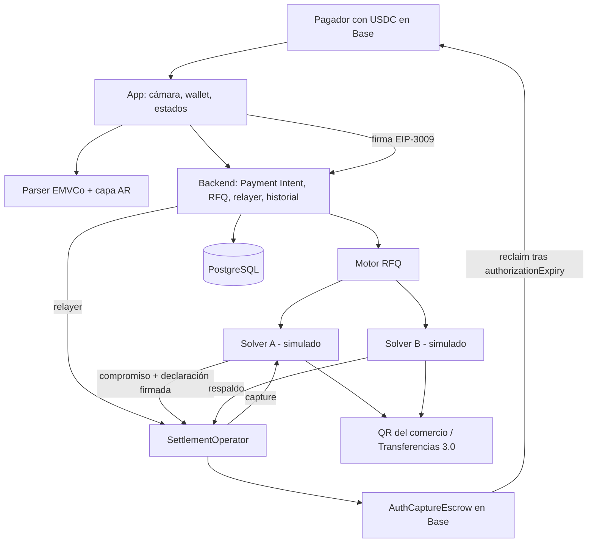
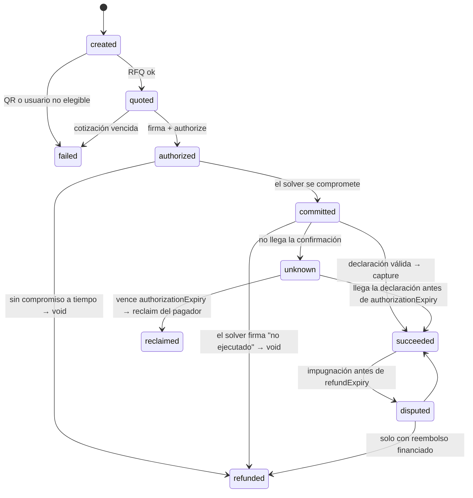

# 04 — Arquitectura técnica: global por diseño, Argentina por ejecución

**Estado:** diseño conceptual. **La arquitectura no está aprobada para fondos reales.** Ninguna pieza está probada en código.
- La demo usa solvers y PSP **simulados**, y un escrow de prueba en testnet.
- Los ADR 0001 y 0002 son **propuestas pendientes**.
- No hay que desplegar contratos con fondos reales antes de cerrar los pendientes de [16 — Modelo de seguridad y liquidación](16-modelo-seguridad-liquidacion.md), §11.

**Documentos relacionados:**
- [15 — Decisiones del stack](15-stack-tecnologico.md)
- [16 — Modelo de seguridad y liquidación](16-modelo-seguridad-liquidacion.md)
- [ADR 0001 — Escrow y autorizaciones](adr/0001-escrow-y-autorizaciones.md)
- [ADR 0002 — Verificación fiat](adr/0002-verificacion-fiat.md)

## Principios de diseño

- **La liquidación primero.** La prioridad es resolver la liquidación entre la red RFQ de solvers y el pago fiat, no sumar integraciones.
- **Sin custodia propia.** El USDC del pagador queda bloqueado en un escrow onchain y nunca en cuentas nuestras. No guardamos claves privadas de usuarios.
- **Los solvers liquidan el ARS.** Un solver (un PSP licenciado, o un mock en la demo) cotiza en el RFQ y paga ARS al QR del comercio.
- **El estado fiat es la verdad del pago.** Un tx hash onchain no implica por sí solo que el comercio recibió ARS.
- **Sin reembolso automático después del compromiso.** El reembolso rápido solo aplica si ningún solver se comprometió. Si el solver pudo haber pagado, el estado es "en verificación", nunca "fallido" (doc 16, §4.3).
- **Ante la duda, cerrar.** Si el QR, la jurisdicción o el usuario no están permitidos, el flujo se detiene antes de la firma.
- **Adaptadores para los rieles, sin ingeniería ficticia.** Las interfaces son generales; solo se implementan los solvers y mercados aprobados.

## Tres alcances

Este documento describe el **protocolo RFQ objetivo**. La demo y el piloto son recortes distintos, y no hay que presentar uno como si fuera otro. El detalle está en el doc 16, §1.1.

| Alcance | Qué incluye | Qué no |
|---|---|---|
| **Demo de hackathon** | Dos solvers simulados, PSP simulado, escrow de prueba en Base Sepolia, declaración firmada de un PSP simulado, las ramas de falla | ARS reales, PSP real, garantías, fondos reales |
| **Protocolo RFQ objetivo** | Red de payment solvers licenciados, `SettlementOperator` con registro y revocación, garantía del solver, evidencia más fuerte | Todavía no existe: es el diseño de estos documentos |
| **Piloto real** | Un solver real en un segmento pequeño y con topes | Solo ocurre si se cumplen las condiciones: acuerdo con proveedores, cumplimiento normativo, spike y pruebas aprobados, auditoría y garantía financiada |

## Flujo de la demo

```text
Payment Intent → RFQ con dos solvers simulados → autorización USDC (EIP-3009 + relayer)
→ compromiso del solver → ejecución fiat simulada → declaración firmada → capture | manejo de fallo
```

## Arquitectura lógica



**Alcance realista:** en la demo, los solvers y el pago fiat están simulados. Un PSP real requiere un acuerdo comercial y que acepte las invariantes I1 e I7 del doc 16. El SDK con UI encapsulada de Yodl no permite el escrow propio, así que solo sirve como referencia o como un solver más en el futuro.

## Componentes y responsabilidades

| Componente | Nuestro control | Tercero |
|---|---|---|
| UI, textos, errores, consentimiento | Sí | — |
| Parser QR y bloqueo de formatos no admitidos | Sí | Especificación del QR interoperable (BCRA) |
| Payment Intent y RFQ | Sí | Cotizaciones firmadas de los solvers |
| Firma del pagador (EIP-3009) | Integración | Wallet del usuario: EOA o smart account (ERC-1271), incluida Base Account. Compatibilidad pendiente del spike |
| Relayer (gas) | Sí; no tiene privilegios sobre los fondos | — |
| `SettlementOperator` (reglas de liquidación) | Sí: contrato mínimo, sin upgrade; ningún rol mueve fondos (doc 16, §8) | — |
| Registro de solvers y atestadores | Gobernanza y guardián (doc 16, §8.1) | Cada solver gestiona sus claves |
| Escrow | No | `AuthCaptureEscrow` de Base: candidato del spike, no aprobado (ADR 0001) |
| Garantía del solver | Sin definir (doc 16, §9.1) | Solver / PSP |
| Ejecución ARS | No | Solver / PSP licenciado |
| Comprobante | Verificación | Declaración firmada del solver o PSP |
| Identidad requerida (KYC) | Políticas y redirección | PSP habilitado |
| Conciliación y soporte | Sí, para nuestras órdenes | Referencias y estados del solver |

## Adaptadores: contrato interno propuesto

Esta interfaz es de **nuestro dominio** y no corresponde a ninguna API real de Yodl, Manteca u otro proveedor.

```ts
type PaymentIntent = {
  intentId: string;
  qrRaw: string;            // never logged in full
  fiatCurrency: 'ARS';
  fiatAmountMinor: string;  // no floats
  createdAt: string;
};

type SolverQuote = {
  quoteId: string;
  intentId: string;
  solverId: string;
  token: 'USDC';
  tokenChainId: number;
  tokenAmountAtomic: string;   // executable price comes from here
  fiatAmountMinor: string;
  feeBreakdown: Array<{ kind: string; amount: string; currency: string }>;
  validUntil: string;          // maps to preApprovalExpiry
  signature: string;           // solver signs the quote
};

type SettlementAttestation = {
  paymentInfoHash: string;
  solverId: string;
  fiatAmountMinor: string;
  railReference: string;       // e.g. transfer/operation id reported by the PSP
  issuedAt: string;
  signature: string;           // EIP-712; a signed claim, not proof of credit
};

interface SolverAdapter {
  canHandleQr(qrRaw: string, country: 'AR'): Promise<boolean>;
  requestQuote(intent: PaymentIntent): Promise<SolverQuote>;
  // Must only execute after the onchain commitment is final (invariant I1).
  executeFiat(paymentInfoHash: string, idempotencyKey: string): Promise<void>;
  getSettlementStatus(paymentInfoHash: string): Promise<'pending' | 'executed' | 'not_executed' | 'unknown'>;
  getAttestation(paymentInfoHash: string): Promise<SettlementAttestation | null>;
}
```

**Advertencia:** un PSP real puede no exponer todas estas operaciones. No hay que forzar el adaptador sobre capacidades que no existen: mapear la integración a lo que el contrato con el PSP permita.

## Estado y conciliación

El modelo completo está en el doc 16, §4. Este es el resumen de estados de negocio:



- `unknown` **nunca** se muestra como fallido ni como reembolsado: el usuario ve "Pago en verificación" y el plazo máximo.
- Los estados de negocio propios no se equiparan automáticamente a los estados de cada solver. Hay que mantener una tabla de mapeo versionada.

## Política de integridad

- `intentId` es un UUID propio. Las referencias externas son únicas por solver.
- La clave de idempotencia del pago fiat deriva de `paymentInfoHash`. El solver rechaza duplicados.
- Un intent por escaneo: si hay un pago en `committed` o `unknown` para el mismo QR, se muestra ese pago y no se crea otro.
- Las actualizaciones por eventos solo pasan a estados permitidos; se rechazan los retrocesos incoherentes.
- Los callbacks se aceptan con firma o HMAC, chequeo de timestamp y protección contra repetición. Los duplicados no cambian estados correctos.
- No se registran en logs el QR completo ni secretos. Onchain van solo hashes, nunca CVU, alias ni nombres.
- La confirmación onchain y la confirmación fiat están desacopladas.

## Evolución

1. Hackathon: dos solvers simulados, USDC en Base Sepolia, el flujo completo con sus ramas de falla.
2. Argentina: un PSP real como solver, si acepta las invariantes y entrega evidencia (doc 16, §7).
3. Un segundo solver real solo si mejora la confiabilidad o el costo y el contrato lo permite.
4. Más activos o redes solo con demanda validada (doc 15, experimentos opcionales).
5. Brasil (Pix) después de validar la demanda y el cumplimiento normativo.
6. Solvers con garantía y slashing (estilo ERC-7683) como visión.

## Decisiones técnicas abiertas

- Spike de `AuthCaptureEscrow` (ADR 0001): expiraciones, compromiso, `capture`, `void`, `reclaim`, confirmación fiat perdida y wallets (EOA, ERC-1271, Base Account). No se construye un escrow propio por ahora.
- Spike de Chainlink CRE (ADR 0002): pedir acceso de despliegue solo si se decide probarlo.
- Plazos de producción: `commitDeadline`, `authorizationExpiry`, `refundExpiry`.
- Garantía de los solvers: alternativas en el doc 16, §9.1, sin elegir. Sin una garantía financiada no hay reembolso después de `capture`.
- Alcance de la suspensión de un solver y composición de la gobernanza (doc 16, §8.5).
- Expo development build o React Native bare, según las dependencias de wallet.
- Qué evidencia bancaria entrega realmente cada PSP, y si hay fixtures reales de QR argentinos.
