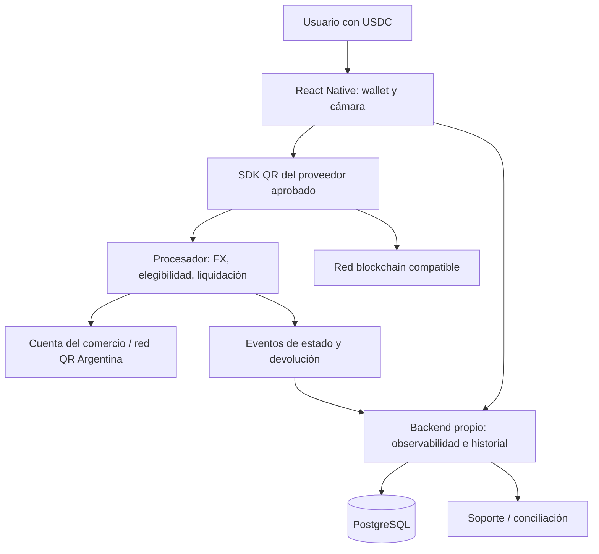
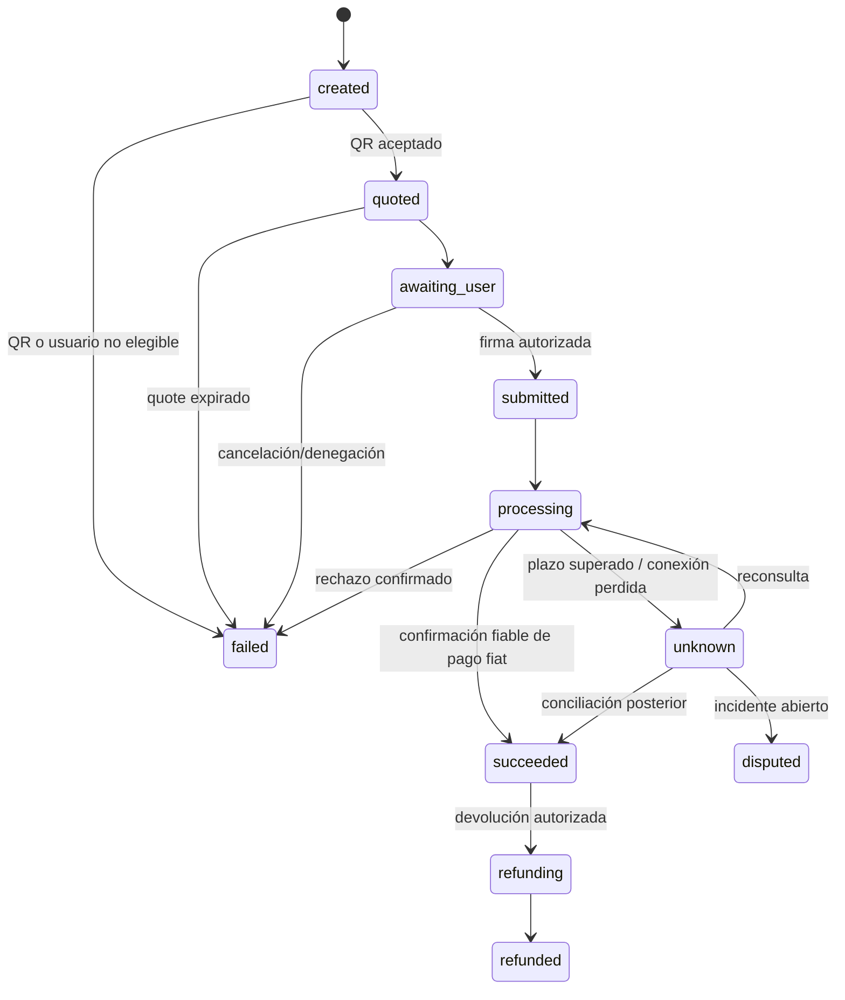

# 04 — Arquitectura técnica: global por diseño, Argentina por ejecución

**Estado:** diseño conceptual; seleccionar proveedor y revisar contrato antes de implementar adaptador real.

## Principios de diseño

- **Una app delgada, proveedor financiero especializado:** no manejar fondos, tipos de cambio ni liquidaciones bancarias de forma propia.
- **Adapters para los rieles; no ingeniería ficticia:** definir interfaces generales, implementar solo el proveedor y mercado aprobados.
- **Estado fiat como verdad de pago:** tx hash onchain nunca implica por sí solo que el negocio recibió ARS.
- **Default fail closed:** QR, jurisdicción o usuario no permitido → detener antes de firma.
- **Circuito sin custodias propias:** no guardar claves privadas ni depósitos de clientes.

## Arquitectura lógica



**Alcance realista:** si se selecciona Yodl, el SDK móvil puede efectuar el flujo incluso sin backend propio. El backend se utiliza para historiales, notificaciones, control de soporte y analítica, y requiere acuerdo e integración aprobados.

## Componentes y responsabilidades

| Componente | Nuestro control | Tercero |
|---|---|---|
| UI, copy, errores, consentimiento | Sí | — |
| Camera/QR guard | Sí | Formatos soportados según SDK |
| Wallet y firma del usuario | Integración | Wallet SDK y usuario |
| Cotización y costo efectivo | Visualización | Procesador/SDK |
| Orquestación fiat/FX | No | Proveedor seleccionado |
| Liquidación ARS | No | PSP/banco y proveedor local |
| Identidad requerida | Políticas y redirección | Proveedor habilitado |
| Onchain settlement | Visualización | Blockchain/proveedor |
| Reconciliación y soporte | Sí para nuestras órdenes | Confirmaciones y callbacks del proveedor |

## Adaptadores: contrato interno propuesto

Esta interfaz es de **nuestro dominio**, no corresponde a ninguna API real de Yodl/Manteca/Interlace.

```ts
type Quote = {
  quoteId: string;
  fiatCurrency: 'ARS';
  fiatAmountMinor: string; // no floats
  token: 'USDC';
  tokenChainId: number;
  tokenAmountAtomic: string;
  feeBreakdown: Array<{ kind: string; amount: string; currency: string }>;
  expiresAt: string;
  processorCode: string;
};

type PaymentStatus =
  | 'created' | 'quoted' | 'awaiting_user'
  | 'submitted' | 'processing'
  | 'succeeded' | 'failed' | 'refunding' | 'refunded'
  | 'unknown' | 'disputed';

interface PaymentProvider {
  canHandleQr(qr: string, country: 'AR'): Promise<boolean>;
  // Solo si el SDK elegido expone una operación equivalente.
  createQuote(input: { qr: string; userRef: string }): Promise<Quote>;
  getPaymentStatus(externalPaymentId: string): Promise<PaymentStatus>;
}
```

**Advertencia:** con SDK UI encapsulado, puede no ser posible construir el `createQuote` por separado. No forzar adaptador sobre capacidades inexistentes; mapear la integración al producto aprobado.

## Estado y conciliación



Estados de negocio propios no se equiparan automáticamente a las cadenas de estado de cada proveedor; crear tabla de mapeo versionada.

## Política de integridad

- `payment_id` UUID propio; `external_payment_id` único por proveedor.
- `idempotency_key` por operación del usuario, con persistencia.
- Actualizaciones por eventos **solo a estados permitidos**; rechazar retrocesos incoherentes.
- HMAC/firmas en callbacks, comparar timestamp, proteger contra repetición.
- Procesar callbacks duplicados sin duplicar ingresos ni alterar estados correctos.
- No registrar QR completo ni secretos en logs, si contienen datos financieros sensibles.
- Desacoplar confirmación onchain de confirmación fiat.

## Evolución regional

1. Argentina: un proveedor, un QR admitido, USDC y red aprobada.
2. Añadir un segundo proveedor solo si mejora confiabilidad/costo y el contrato lo permite.
3. Brasil (Pix) tras validar demanda y cumplimiento; adaptar formatos/estados/cobertura.
4. API/SDK propio únicamente con dos clientes empresariales comprometidos.
5. Beneficios y comercios adheridos como módulo separado (`merchant-benefits`) y sin financiamiento cruzado automático.

## Decisiones técnicas abiertas

- Expo development build vs React Native bare según SDK y dependencias nativas.
- Webhook API, historial y almacenamiento con consentimiento; no crear backend innecesario.
- Proveedor de autenticación solo para historial; no crear cuentas por obligación si el SDK no las necesita.
- Soporte al usuario final por socios o por nosotros: contractual.
- Disponibilidad de prueba de pago fiat y fixtures reales de QR argentinos.
