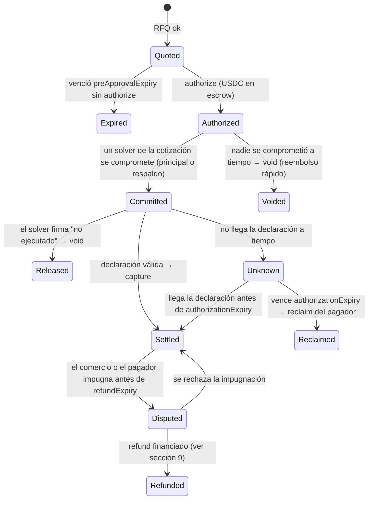

# 16 — Modelo de seguridad y liquidación

**Estado:** borrador de diseño. **La arquitectura no está aprobada para fondos reales.** Nada de este documento está probado en código. No desplegar contratos con fondos reales hasta cerrar los pendientes de la sección 11.

**Etiquetas de evidencia usadas en este documento:**

- **[Verificado en fuente]**: comprobado leyendo código o documentación oficial (enlace incluido).
- **[Simulado]**: existirá en la demo, pero con un actor simulado (por ejemplo, un PSP mock).
- **[Pendiente]**: supuesto o dato no verificado todavía.
- **[Diseño]**: decisión propia que todavía no se implementó.

## 1. Alcance, propiedades y riesgos asignados

### 1.1 Tres alcances que no hay que mezclar

| | Demo de hackathon | Protocolo RFQ objetivo | Piloto real |
|---|---|---|---|
| Qué es | Prueba del flujo y de sus fallas | El diseño al que apuntamos | Operación con dinero real, **condicionada** |
| Solvers | Dos, simulados | Varios PSP licenciados que cotizan y liquidan | Al menos uno real, con acuerdo firmado |
| Pago fiat | Simulado; no se mueve ARS | Transferencias 3.0 vía el PSP del solver | Real, en un segmento pequeño y autorizado |
| Escrow | `AuthCaptureEscrow` en Base Sepolia (escrow de prueba) | Candidato, sujeto al spike (ADR 0001) | Solo si el spike y la revisión de seguridad lo aprueban |
| Comprobante | Declaración firmada de un PSP simulado | Declaración del PSP, con interfaz para evidencia más fuerte | La evidencia que el PSP entregue de verdad (§7) |
| Garantía del solver | No hay; se simula el estado | Una de las alternativas de §9 | Elegida y financiada antes de empezar |
| Fondos | USDC de testnet | — | Reales, con topes |
| Condiciones | Ninguna externa | — | Proveedores, cumplimiento normativo, pruebas, auditoría y garantías |

Todo lo que sigue describe el **protocolo objetivo**. Cuando algo aplica solo a la demo, lleva la etiqueta [Simulado].

### 1.2 Propiedades que el diseño busca

Cada propiedad vale solo bajo las condiciones que se indican. No son promesas incondicionales.

| ID | Propiedad | Quién la hace cumplir | Condiciones |
|---|---|---|---|
| P1 | **Salidas acotadas.** El USDC bloqueado solo sale del escrow por tres caminos: `capture` con una declaración válida, `void` hacia el pagador, o `reclaim` del pagador | Contratos | `SettlementOperator` correcto (I2–I5) y escrow correcto |
| P2 | **Recuperación con plazo máximo.** Si no hubo `capture`, el pagador recupera el 100 % a más tardar en `authorizationExpiry`, sin depender de nosotros | `reclaim` del escrow [Verificado en fuente] | Base operativa; USDC no pausado y el pagador fuera de la lista de bloqueo del emisor |
| P3 | **Cobro del solver que cumple y prueba a tiempo.** Un solver que se comprometió, pagó y presentó una declaración válida **antes de `authorizationExpiry`** cobra el USDC | `SettlementOperator` | La declaración llega onchain a tiempo (cualquiera puede enviarla); la clave del atestador sigue vigente |
| P4 | **Una sola ejecución fiat por pago.** | Solver y PSP, fuera de la cadena | El solver cumple I1 e I7. **No se puede verificar onchain** |
| P5 | **Sin custodia ni control administrativo de fondos.** Ningún rol puede mover fondos bloqueados ni cambiar las reglas de un pago ya autorizado | `SettlementOperator` (I9) | Revisión de código y auditoría [Pendiente] |

### 1.3 Lo que el diseño no garantiza

- **Que el comercio cobró.** El comprobante es una declaración firmada, no una prueba de acreditación (§7).
- **Atomicidad entre el tramo cripto y el fiat.** El pago en ARS es irrevocable (push de Transferencias 3.0); el USDC se libera después y por separado.
- **Que el solver que pagó siempre cobra.** Si no puede probarlo antes de `authorizationExpiry`, pierde (riesgo R1).
- **Reembolso después de `capture`.** Solo existe si alguien lo financia (§9).
- **Un plazo corto en el caso incierto.** Con un solver comprometido, el pagador puede esperar hasta `authorizationExpiry`.

### 1.4 Riesgos y quién los asume

| ID | Riesgo | Quién lo asume | Mitigación | Estado |
|---|---|---|---|---|
| R1 | El solver pagó ARS y no logra probarlo antes de `authorizationExpiry` (API caída, webhook perdido) | **Solver**: pierde el USDC frente al `reclaim` | `authorizationExpiry` largo; cualquiera puede enviar la declaración; reintentos | Tiene que aceptarlo en su acuerdo [Pendiente] |
| R2 | El solver se compromete y después no paga ni libera el pago | **Pagador**: espera hasta `authorizationExpiry`; no pierde fondos | Solo pueden comprometerse los solvers de la cotización firmada; penalización con la garantía (§9); suspensión | [Diseño] |
| R3 | Declaración falsa (solver deshonesto o clave comprometida): se captura sin que el comercio haya cobrado | **Pagador**, salvo que exista un reembolso financiado | Revocación y suspensión (§8); ventana de disputa; garantía del solver (§9) | Sin mitigación completa en el MVP |
| R4 | El solver paga sin esperar la confirmación de su compromiso (viola I1) y el pago se anula | **Solver** | Verificación en su adaptador; acuerdo | [Pendiente] |
| R5 | Doble pago fiat por falla de idempotencia | Quien la causó: el solver o PSP si ignoran la clave; nosotros si la app creó dos intents | Cuatro capas de §6 | [Diseño] |
| R6 | Bug en `SettlementOperator` | Pagador o solver | Contrato mínimo, tests de invariantes, auditoría; sin fondos reales hasta entonces | [Pendiente] |
| R7 | Bug en `AuthCaptureEscrow` | Pagador o solver | Código de un tercero con auditorías publicadas; spike del ADR 0001 | [Pendiente] |
| R8 | El emisor pausa USDC o bloquea una dirección: `FiatTokenV2_2` aplica `whenNotPaused` y `notBlacklisted` a las transferencias ([fuente](https://github.com/circlefin/stablecoin-evm/blob/master/contracts/v2/FiatTokenV2_2.sol)) | Quien tenga fondos en tránsito | Ninguna; es riesgo del emisor | [Verificado en fuente] |
| R9 | Base o el relayer caen cerca de `authorizationExpiry` | **Solver** (no llega a capturar) | Plazo con margen; envío sin permisos | [Diseño] |
| R10 | Backend comprometido: cotizaciones maliciosas o selección de un solver cómplice | Pagador, hasta el monto que firmó | El pagador ve y firma el monto; solvers registrados; ver la limitación de §8.3 | [Diseño] |

**La tensión de fondo:** un `authorizationExpiry` más largo reduce R1 (protege al solver) y agranda R2 (el pagador espera más si el solver no cumple). No existe un plazo que elimine los dos. El valor de producción es una decisión pendiente (§11).

## 2. Flujo

```text
Payment Intent → RFQ (2 solvers simulados) → autorización USDC → compromiso del solver
→ ejecución fiat simulada → comprobante → captura (liquidación) | manejo de fallo
```

| Paso | Qué pasa | Actor | Evidencia |
|---|---|---|---|
| 1. Payment Intent | Se parsea el QR, se fija el monto en ARS y se genera `intentId` | App + backend | [Diseño] |
| 2. RFQ | Se piden cotizaciones a 2 solvers; cada una va firmada (`intentId`, USDC, ARS, `validUntil`, `solverId`) | Solvers | [Simulado] |
| 3. Selección | Se elige la mejor cotización y se conserva la segunda como respaldo | Backend (motor RFQ) | [Diseño] |
| 4. Autorización | El pagador firma una `ReceiveWithAuthorization` (EIP-3009) atada al `PaymentInfo`; un relayer envía la transacción y paga el gas | Pagador + relayer | Mecánica [Verificado en fuente] |
| 5. Bloqueo | `SettlementOperator` llama `AuthCaptureEscrow.authorize`; el USDC queda en escrow | Contratos | Semántica del escrow [Verificado en fuente] |
| 6. Compromiso | El solver elegido registra onchain que va a ejecutar el pago fiat de ese `paymentInfoHash` | Solver | [Diseño] |
| 7. Ejecución fiat | El solver paga ARS al QR del comercio, solo después de que su compromiso tenga confirmación onchain | Solver | [Simulado] |
| 8. Comprobante | El solver entrega una declaración firmada (EIP-712) con la referencia del rail | Solver / atestador | [Simulado] |
| 9. Liquidación | `SettlementOperator` verifica la declaración y llama `capture` | Contratos | [Diseño] |
| 10. Falla | Las ramas de la sección 4 | Ver sección 4 | [Diseño] |

## 3. Lo que el escrow permite y no permite

Comportamiento de `AuthCaptureEscrow` v1.1.0, verificado en el código fuente ([`AuthCaptureEscrow.sol`](https://github.com/base/commerce-payments/blob/main/src/AuthCaptureEscrow.sol)) **[Verificado en fuente]**. Es el **candidato del spike**, no una decisión tomada (ADR 0001).

| Función | Quién la llama | Ventana de tiempo | Efecto |
|---|---|---|---|
| `authorize` | solo `operator` | `block.timestamp < preApprovalExpiry` | Mueve el USDC del pagador al escrow |
| `capture` | solo `operator` | `block.timestamp < authorizationExpiry` | Paga al `receiver` (menos fees) |
| `void` | solo `operator` | sin límite de tiempo | Devuelve al pagador lo no capturado |
| `reclaim` | solo `payer` | `block.timestamp >= authorizationExpiry` | El pagador recupera lo no capturado, sin el operador |
| `refund` | solo `operator` | `block.timestamp < refundExpiry` | Devuelve fondos ya capturados; **los fondos los aporta el lado del operador** |

Consecuencias para nuestro diseño:

- **`authorizationExpiry` es un límite duro para el solver.** Después de esa hora ya no se puede capturar, y el pagador puede hacer `reclaim`. Ese plazo va dentro del `PaymentInfo` firmado, así que **no se puede extender** una vez firmado.
- **`void` es inmediato**, pero solo lo ejecuta el operador. Como el operador es nuestro contrato `SettlementOperator`, las reglas de cuándo se permite `void` las definimos nosotros, en código.
- `ERC3009PaymentCollector` usa `receiveWithAuthorization`, con `nonce = _getHashPayerAgnostic(paymentInfo)` y `validBefore = preApprovalExpiry` ([fuente](https://github.com/base/commerce-payments/blob/main/src/collectors/ERC3009PaymentCollector.sol)) **[Verificado en fuente]**. Una misma firma no se puede usar para dos pagos distintos.
- `capture` se puede llamar varias veces hasta agotar lo autorizado **[Verificado en fuente]**. El `SettlementOperator` tiene que capturar una sola vez y por el monto exacto.

## 4. Máquina de estados de liquidación



### 4.1 La regla central

> **El reembolso automático rápido (`void`) solo es posible ANTES de que el solver se comprometa. Después del compromiso no hay reembolso automático por timeout.**

Esta regla se apoya en la invariante I1: **el solver no puede ejecutar el pago fiat sin un compromiso confirmado onchain.** Si se cumple, un `Authorized` sin compromiso garantiza que nadie pagó ARS, y devolver los fondos es seguro.

### 4.2 Failover entre solvers

- Si el solver A no se compromete antes de `commitDeadline` (de 1 a 2 minutos en el diseño), el solver de respaldo B puede comprometerse al mismo `paymentInfoHash`, siempre que acepte el monto ya autorizado.
- **Para eso, el `receiver` del `PaymentInfo` no puede ser la dirección de A.** Tiene que ser nuestro `SettlementOperator`, que reenvía lo capturado al solver que se comprometió. **[Diseño]** Esto suma superficie de confianza en un contrato propio; por eso tiene que ser pequeño y con los permisos de §8.
- Si nadie se compromete antes de `commitDeadline × 2`, el estado pasa a `Voided`.

### 4.3 El caso crítico: el solver pagó y se perdió la confirmación

Situación: el solver se comprometió, pagó ARS al comercio (irrevocable) y el comprobante no llega, por una caída de la API del PSP, un webhook perdido o un relayer caído.

| Pregunta | Respuesta del diseño |
|---|---|
| ¿Se devuelve el USDC por timeout? | **No.** El estado `Committed` no permite `void`. El pago queda en `Unknown`, no en "fallido". |
| ¿Cuánto espera el pagador? | Hasta `authorizationExpiry`, un plazo largo elegido al firmar. En producción es [Pendiente] (entre 24 y 72 h a evaluar); en la demo, minutos. |
| ¿Qué hace el sistema mientras tanto? | Reconsulta al solver/PSP con la clave de idempotencia y reintenta enviar la declaración. Puede enviarla cualquiera, no solo nuestro backend. |
| ¿Y si la declaración nunca llega? | Al vencer `authorizationExpiry`, el pagador puede hacer `reclaim`. Lo garantiza el escrow y nadie puede bloquearlo, salvo el riesgo R8. |
| ¿Quién asume esa pérdida? | **El solver** (riesgo R1). Es un riesgo asignado de forma explícita, no un caso que el diseño evite. |
| ¿Por qué no extender el plazo? | `authorizationExpiry` está en el `PaymentInfo` firmado y el escrow no permite cambiarlo [Verificado en fuente]. |
| ¿Qué ve el usuario? | "Pago en verificación", con el plazo máximo visible. Nunca "falló" ni "reembolsado" mientras el estado sea `Unknown`. |

Este caso es el objetivo principal del spike (ADR 0001, grupo E de pruebas).

### 4.4 Otros estados inciertos

| Situación | Tratamiento |
|---|---|
| La firma del pagador llega después de `preApprovalExpiry` | `authorize` revierte, no se mueve nada y se pide una nueva cotización |
| La tx de `authorize` está pendiente | El solver no ve un `Authorized` confirmado, así que no se compromete |
| La tx de compromiso está pendiente | El solver no paga ARS hasta que la confirmación sea final (invariante I1) |
| El PSP responde timeout al pagar ARS | `Unknown`; reconsultar con la clave de idempotencia; nunca reintentar el pago a ciegas |
| El PSP informa "fallido" y después aparece acreditado | Se trata como `Settled` si llega una declaración antes de `authorizationExpiry`; queda registrado como incidente |
| La tx de `capture` revierte | Reintentar mientras `block.timestamp < authorizationExpiry`; alertar a medida que se acerca el vencimiento |
| Reorg de Base | El solver espera el bloque marcado como *safe* o *finalized* antes de pagar ARS [Pendiente: definir umbral] |

## 5. Invariantes

Antes de manejar fondos reales, cada una tiene que tener un test, o una justificación de por qué no lo necesita.

| ID | Invariante | Dónde se hace cumplir |
|---|---|---|
| I1 | Ningún solver ejecuta el pago fiat sin un compromiso onchain confirmado para ese `paymentInfoHash` | Acuerdo con el solver + verificación en su adaptador; **no se puede hacer cumplir onchain** |
| I2 | Hay como mucho un compromiso activo por `paymentInfoHash` | `SettlementOperator` |
| I3 | `void` solo es posible si no hay un compromiso activo, o si el solver comprometido firmó "no ejecutado" | `SettlementOperator` |
| I4 | `capture` solo es posible con una declaración válida, de un atestador registrado y no revocado, que corresponda al `paymentInfoHash`, al monto y al solver comprometido | `SettlementOperator` |
| I5 | Lo capturado solo llega a la dirección de cobro registrada del solver que se comprometió | `SettlementOperator` como `receiver` |
| I6 | Una autorización de pago (firma) no sirve para un segundo pago | Nonce de `ERC3009PaymentCollector` [Verificado en fuente] |
| I7 | Cada pago fiat lleva una clave de idempotencia derivada de `paymentInfoHash`, y el solver rechaza duplicados | Adaptador del solver / PSP [Pendiente: confirmar que el PSP lo soporte] |
| I8 | El pagador siempre puede recuperar lo no capturado después de `authorizationExpiry`, aunque nosotros desaparezcamos | `reclaim` de `AuthCaptureEscrow` [Verificado en fuente] |
| I9 | Ningún rol (gobernanza, guardián, relayer) puede mover fondos, capturar, anular fuera de las reglas ni cambiar un pago ya autorizado | `SettlementOperator` (§8.1); revisión de código + auditoría [Pendiente] |
| I10 | Ningún dato personal (CVU, nombre, alias) se guarda en claro onchain; solo hashes | Diseño de eventos |
| I11 | La autorización queda atada al intent: el `salt` del `PaymentInfo` deriva de `intentId`, `quoteId`, monto ARS, hash del QR y los solvers de la cotización | Backend al construir el `PaymentInfo`; `SettlementOperator` al verificarlo [Diseño] |
| I12 | Solo puede comprometerse un solver registrado, activo y nombrado en la cotización de ese pago | `SettlementOperator` |
| I13 | Cada pago se captura una sola vez y por el monto exacto de la cotización | `SettlementOperator` |

## 6. Prevención de pagos duplicados

Hay cuatro capas, porque ninguna alcanza sola:

1. **Firma de un solo uso:** el nonce de EIP-3009 deriva del `PaymentInfo` (I6).
2. **Compromiso exclusivo:** un solo solver por pago a la vez (I2).
3. **Idempotencia en el rail:** la misma clave nunca genera dos transferencias ARS (I7).
4. **Un intent por escaneo:** si el pagador vuelve a escanear el mismo QR mientras hay un pago en `Committed` o `Unknown`, la app le muestra el pago en curso en lugar de crear otro.

La capa 4 es la que evita el doble pago clásico: el usuario ve "falló", paga de nuevo, y el primer pago en realidad se había acreditado. Por eso el estado `Unknown` nunca se muestra como fallido.

## 7. Comprobante: firma frente a prueba de acreditación

**Una firma demuestra quién hizo una declaración, no que el comercio cobró.** Para no confundir las dos cosas, el comprobante se clasifica en niveles:

| Nivel | Qué es | Qué demuestra | Disponible en el MVP |
|---|---|---|---|
| E0 | Estado en nuestro backend | Nada verificable por terceros | Sí |
| E1 | Declaración firmada del solver (EIP-712: `paymentInfoHash`, monto ARS, referencia del rail, timestamp) | Quién se responsabiliza por el pago. Si es falsa, hay un responsable identificable | **Sí [Simulado]** |
| E2 | Declaración firmada del PSP licenciado (distinto del solver, si no son el mismo) | Responsabilidad de una entidad regulada | [Pendiente: depende del contrato con el PSP] |
| E3 | Varios nodos independientes consultan la API del PSP (Chainlink CRE) | Que el PSP informa ese estado. Saca a nuestro backend del medio, pero **sigue siendo la palabra del PSP** | Spike separado ([ADR 0002](adr/0002-verificacion-fiat.md)) |
| E4 | Confirmación del lado del comercio (zkTLS sobre su cuenta, o su acuse) | Que el comercio vio el crédito | Visión; requiere que el comercio coopere |
| E5 | Prueba del rail o del banco receptor (COELSA / banco del comercio) | Acreditación efectiva | **No disponible para nosotros** [Pendiente: confirmar qué expone el PSP] |

Reglas de lenguaje:

- En la demo y en el pitch, el comprobante del MVP se llama **"declaración firmada del proveedor"**. Nunca "prueba de acreditación".
- "Comprobante verificable" significa que cualquiera puede verificar la firma y la referencia, no la acreditación.

**Qué evidencia bancaria podríamos obtener de verdad** [Pendiente: preguntar a Manteca y a otros PSP]:

- un ID de operación de Transferencias 3.0 o COELSA, y su estado, informado por el PSP;
- el CVU o alias de destino y el monto, en el payload del PSP;
- la notificación al comercio, que llega al comercio, no a nosotros;
- si el PSP firma webhooks o respuestas, con qué clave y bajo qué responsabilidad contractual.

## 8. `SettlementOperator`: registro, permisos y claves

Todo este apartado es **[Diseño]**. Es la especificación que el spike y la revisión de seguridad tienen que validar.

### 8.1 Roles y permisos

| Rol | Puede | No puede |
|---|---|---|
| **Gobernanza del registro** (multisig en un piloto; una clave de prueba en la demo) | Proponer el alta de un solver, con demora antes de que surta efecto; dar de baja; reactivar un solver suspendido | Mover fondos, capturar, anular, tocar pagos ya autorizados, cambiar la dirección de cobro de un solver |
| **Guardián** (clave operativa de emergencia) | Suspender un solver de inmediato | Reactivarlo, dar altas, mover fondos |
| **Solver** | Comprometerse a pagos en cuya cotización figura; firmar "no ejecutado"; agregar claves de atestador (con demora) y revocarlas (de inmediato); proponer un cambio de su dirección de cobro (con demora) | Comprometerse a pagos ajenos; cobrar en una dirección no registrada |
| **Atestador** (clave del solver o de su PSP) | Firmar declaraciones de liquidación | Nada onchain por sí mismo |
| **Relayer, o cualquier cuenta** | Enviar la autorización firmada del pagador; enviar una declaración para capturar; ejecutar `void` cuando las reglas lo permiten | Nada que las reglas no permitan: no tiene privilegios |
| **Pagador** | `reclaim` directo en el escrow después de `authorizationExpiry` | — |

Principios:

- **Las funciones de liquidación no tienen permisos.** `capture` y `void` dependen de las reglas y de las firmas, no de quién envía la transacción. Así nuestro relayer no es un punto único de falla.
- **Sin upgrade.** Una versión nueva es un contrato nuevo. Los pagos autorizados con la versión anterior terminan en la anterior, porque el `operator` va dentro del `PaymentInfo` firmado.

### 8.2 Registro de solvers y atestadores

- Por solver: `solverId`, dirección de cobro, estado (`activo`, `suspendido`, `baja`) y lista de claves de atestador, cada una con `validFrom` y `revokedAt`.
- **Alta:** la propone la gobernanza y surte efecto después de una demora. Eso da tiempo a detectar un alta maliciosa.
- **Suspensión:** inmediata, por el guardián. Un solver suspendido no puede tomar compromisos nuevos.
- **Claves de atestador:** las agrega el solver, con demora. Las revoca el solver, de inmediato.
- **Vigencia:** una declaración se acepta solo si la clave estaba vigente **en el bloque en que se envía**. El `timestamp` declarado no cuenta, porque quien tiene una clave robada puede falsificarlo.
- **Dirección de cobro:** se fija en el alta. Un cambio tiene demora y no afecta a los pagos en curso. Una clave de atestador robada no permite desviar fondos a otra dirección.

### 8.3 Cómo se impide una captura indebida

`capture` solo procede si se cumplen **todas** estas condiciones:

1. Hay un compromiso activo para ese `paymentInfoHash` (I2).
2. El solver comprometido está registrado y figura en la cotización del pago (I12).
3. La declaración está firmada por una clave de atestador de **ese** solver, vigente en el bloque de envío (I4).
4. La declaración coincide en `paymentInfoHash`, monto y `solverId`.
5. La declaración no se usó antes, y el pago no fue capturado (I13).
6. El monto capturado es exactamente el de la cotización.
7. El destino es la dirección de cobro registrada del solver (I5).
8. `block.timestamp < authorizationExpiry` (lo exige el escrow).

**Limitación que hay que tener presente:** lo que la wallet le muestra al pagador es una `ReceiveWithAuthorization` con monto, destinatario (el contrato collector), vigencia y un `nonce` opaco. El vínculo con el intent y con los solvers está dentro de ese nonce, y el pagador no lo puede leer. Depende de que la app construya el `PaymentInfo` de forma honesta (riesgo R10). [Pendiente: confirmar en el spike si la firma cubre `maxAmount` o el monto exacto.]

### 8.4 Respuesta a claves comprometidas

| Clave comprometida | Qué puede hacer el atacante | Respuesta |
|---|---|---|
| Atestador de un solver | Firmar declaraciones falsas para los pagos **comprometidos por ese solver**; los fondos van a la dirección legítima del solver, no al atacante | El solver revoca la clave de inmediato; el guardián suspende al solver; los pagos afectados pasan a disputa (riesgo R3) |
| Clave operativa del solver (la que toma compromisos) | Comprometerse sin pagar y bloquear pagos hasta `authorizationExpiry` (riesgo R2) | Suspensión por el guardián; rotación; los pagadores recuperan por `reclaim` |
| Relayer | Gastar su saldo de gas; demorar envíos | Rotarla. No hay riesgo para los fondos, porque no tiene privilegios |
| Guardián | Suspender solvers sin motivo (denegación de servicio) | La gobernanza reactiva y reemplaza al guardián |
| Gobernanza | Proponer el alta de un solver malicioso | La demora del alta permite detectarlo; aun así, ese solver solo podría comprometerse a pagos que lo nombren en la cotización firmada |
| Backend (motor RFQ) | Presentar cotizaciones malas o elegir un solver cómplice | El pagador firma un monto visible; riesgo R10 |

### 8.5 Decisiones abiertas del operador

- **Alcance de la suspensión.** La propuesta por defecto es que solo bloquee compromisos nuevos. Congelar también las capturas de ese solver protege al pagador frente a declaraciones falsas, pero perjudica los pagos honestos en curso: si el congelamiento dura hasta `authorizationExpiry`, el solver pierde. Hay que decidirlo antes de un piloto.
- Duración de las demoras (alta de solver, clave de atestador, cambio de dirección).
- Quién integra la gobernanza y quién opera el guardián en un piloto.

## 9. Reembolsos posteriores a `capture` y garantía del solver

**Después de `capture`, el USDC ya salió del escrow. No existe una devolución automática sin fondos o sin una responsabilidad contractual que la respalde.**

- En `AuthCaptureEscrow`, `refund` lo ejecuta solo el operador, antes de `refundExpiry`, y **los fondos se toman del lado del operador** mediante un collector de reembolso **[Verificado en fuente]**. El contrato no puede sacarle fondos al solver por sí solo.
- Por eso, las transiciones `Disputed → Refunded` de la sección 4 solo son reales si existe una de las alternativas de abajo.
- **[Simulado]** En la demo no hay garantía: el estado `Disputed` se muestra, y un eventual reembolso se financia con USDC de testnet.

### 9.1 Alternativas de garantía (sin elegir una para producción)

| Alternativa | Cómo financia el reembolso | A favor | En contra |
|---|---|---|---|
| **A. Garantía depositada onchain** (bond) | El solver deposita USDC por adelantado; el reembolso y las penalizaciones salen de ahí | Automática y verificable; también cubre R2 | Inmoviliza capital del solver; limita su volumen; hay que definir quién decide una ejecución de garantía |
| **B. Retención** (pago diferido) | Lo capturado, o una parte, queda retenido en el `SettlementOperator` hasta `refundExpiry` | No exige capital previo | El solver cobra tarde, y ya adelantó los ARS: costo financiero alto |
| **C. Responsabilidad contractual** | El PSP licenciado se obliga por contrato a devolver | Sin capital inmovilizado; encaja con entidades reguladas | No es automática ni verificable onchain; depende de la vía legal |
| **D. Fondo común** | Una parte del fee de cada pago alimenta un fondo que cubre reembolsos | No depende de un solver puntual | Tarda en acumularse; reparte entre todos el costo de los incumplidores |
| **E. Garantía de un tercero** (seguro o aval) | Un tercero cubre los incumplimientos | Transfiere el riesgo | Costo y disponibilidad sin confirmar [Pendiente] |

Las alternativas se pueden combinar (por ejemplo, C para el piloto con un PSP licenciado y A para solvers sin licencia). **No se elige ninguna todavía.** Cualquiera exige definir además quién resuelve una disputa y con qué evidencia.

### 9.2 Disputas

- La ventana de disputa va de la captura hasta `refundExpiry` [Pendiente: definir plazo].
- En el MVP las disputas se resuelven offchain y manualmente. **[Simulado]**: la demo muestra el estado `Disputed`, no un tribunal.

## 10. Responsabilidades por actor

| Actor | Responsable de | Riesgos que asume (§1.4) |
|---|---|---|
| Pagador | Firmar solo el monto y los vencimientos que ve | R2 (espera), R3 (si no hay reembolso financiado) |
| App y backend (nosotros) | Cotizar, mostrar estados honestos, retransmitir declaraciones, operar el relayer | Reputación; costo de gas; R5 si creamos intents duplicados. **No custodiamos fondos** |
| `SettlementOperator` (contrato) | Hacer cumplir I2–I5, I9, I11–I13 | R6 |
| `AuthCaptureEscrow` (Base) | Guardar los fondos y respetar los vencimientos | R7 |
| Solver | Comprometerse solo si puede pagar; pagar solo después del compromiso; probar antes de `authorizationExpiry`; cuidar sus claves | R1, R4, R9, y lo que cubra su garantía |
| PSP licenciado | Ejecutar el ARS, dar referencia e idempotencia, firmar estados | Lo que diga su contrato [Pendiente] |
| Gobernanza y guardián | Altas, bajas y suspensiones | Errores de registro; no tocan fondos |
| Comercio | Nada en el MVP; cobra en su QR de siempre | — |

## 11. Pendientes antes de manejar fondos reales

1. Ejecutar el spike del ADR 0001: expiraciones, compromiso, `capture`, `void`, `reclaim`, confirmación fiat perdida y compatibilidad de wallets.
2. Confirmar con al menos un PSP qué evidencia expone (§7) y si acepta I1, I7 y el riesgo R1.
3. Fijar `commitDeadline`, `authorizationExpiry` y `refundExpiry` para producción, con datos de latencia reales.
4. Elegir y financiar la garantía del solver (§9.1), y definir quién resuelve disputas.
5. Cerrar las decisiones abiertas del operador (§8.5).
6. Tests de invariantes y de fuzz de la máquina de estados del `SettlementOperator`.
7. Revisión de seguridad o auditoría del `SettlementOperator`.
8. Definir el umbral de finalidad en Base antes de que el solver pague ARS.
9. Revisión de cumplimiento normativo de la actividad (después de la hackathon).
